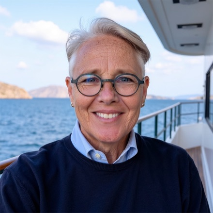

# Resume {#resume-h1}

{: style="width:220px"}

## Summary

!!!tip inline end "LinkedIn"

    For a detailed view of my endeavors, see my [linkedin.com/in/jburdekin](https://www.linkedin.com/in/jburdekin/){:target="_blank"} profile.

Content isn't a sales asset. It's how organizations manifest consciousness. Structured, it remembers; connected, it learns. I've spent thirty years designing those connections — at Macromedia, Adobe, Planet Labs, and Geospan — and now through Allostasis AI, building the semantic layer that lets AI agents act on designed context instead of guesswork.

## Experience

### Founder — Allostasis AI · October 2023 – Present

Independent knowledge-engineering practice focused on agent-readiness: the principles, workflows, reference knowledge, and evals that let agents act on designed context rather than guesswork. Built Towndraft, an agentic pipeline on FastAPI, Next.js, and Supabase/pgvector whose agents work from a versioned knowledge graph. Runs spec-driven development as standard practice. Author of the [Agent-Readiness Field Guide](https://allostasis.ai/agent-readiness){:target="_blank"} — *Organizational legibility: six layers, seven tests* — and [*Build Your Semantic Infrastructure First*](https://gnowledge-karden.ghost.io/build-your-semantic-infrastructure-first/){:target="_blank"}.

### Technical Content Engineer — Geospan, Inc. · August 2024 – August 2025

Built first-generation developer documentation, Python and JavaScript code examples, and Postman collections for integration partners. Delivered a Hugo CMS redesign and HubSpot Knowledge Base, establishing the internal developer experience for a new engineering team.

### Head of Developer Relations — Planet Labs, PBC · October 2021 – October 2023

Scaled from developer relations content developer to head of function. Led development of the Planet SDK and CLI for Python and built knowledge systems serving agriculture, forestry, and government through a remote-sensing and geospatial platform.

### Founder — Abevy, Inc. · April 2015 – June 2024

Benefit corporation building technical forums and software prototypes with and for older women in tech.

### Senior Web Developer & Technical Lead — Viscira · February 2016 – February 2019

Frontend and data-visualization work for life sciences in Angular, D3, GSAP, and Bootstrap; led web and mobile development teams.

### Content Strategist & Senior Manager — Adobe Systems · June 2006 – March 2015

Content strategy for Adobe's Web Platform initiatives; W3C Steward Representative. Built data pipelines in SQL, Hadoop, Hive, and NLTK, and product managed the ActionScript Reference platform.

### Documentation Manager & Lead Writer — Macromedia, Inc. · 2000 – 2006

Documentation architecture for Dreamweaver, Flash, ActionScript, and Flash Media Server; introduced automated tooling (Doxygen, ASDoc).

### Lead Writer — RSA Security · 1995 – 2000

API documentation for cryptographic security products, including certificate servers and desktop security software.

## Education

### Mills College, Oakland, California · 1991 – 1995

BA, English, with interdisciplinary study in computer science and philosophy of science

:fontawesome-solid-paper-plane: <juburdekin@gmail.com>{:target="_blank"} | :fontawesome-brands-linkedin: [linkedin.com/in/jburdekin](https://www.linkedin.com/in/jburdekin/){:target="_blank"}
